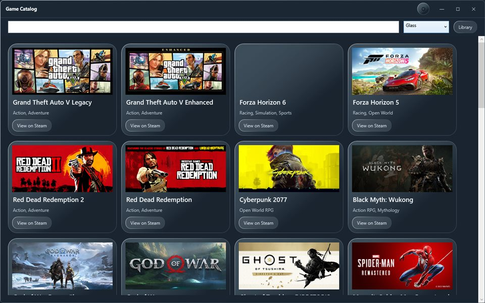

# Steam Vetra

**[Português](#português) · [English](#english)**



Capturas adicionais enviadas pelo autor / Additional screenshots supplied by the author (may show earlier private flows):


## Português

Esta edição mantém a interface original, o catálogo, a biblioteca e a integração Lua Tools. O **sistema de chaves de produto foi removido**. A chave pessoal da API Ryuu não está no código, no `appsettings.json` nem nas imagens. O módulo anti-crack também não faz parte do repositório.

### Recursos

| Recurso | Estado |
| --- | --- |
| Catálogo, busca e capas | Funcional; imagens locais e da Steam. |
| Biblioteca e perfil | Locais no computador; nome, foto e coleção. |
| Temas | Glass, GTA 6 e CodeNexus. |
| Injection Tools | Integração preservada para consultar metadados, baixar/importar Lua e manifestos, provisionar arquivos na pasta configurada da Steam e acionar o cliente Steam. |
| Fixes | Interface e serviços de consulta, aplicação e reversão preservados. Arquivos remotos dependem da disponibilidade dos serviços externos. |
| Ativação por chave | Removida. Não há validação, HWID de licença ou chave de produto nesta edição. |

**O build não prova o fluxo remoto de ponta a ponta.** Sem credencial Ryuu, requisições que a API exigir autenticar podem falhar. O programa não simula sucesso quando a consulta remota falha. `Simulate manifests locally` é uma opção de teste explícita; seus resultados não comprovam um manifesto real.

### Requisitos e execução

- Windows 10/11 x64, [.NET 8 SDK](https://dotnet.microsoft.com/download/dotnet/8.0), PowerShell.
- Internet para restaurar NuGet e consultar os serviços externos.
- Steam e a integração Lua Tools/OpenSteamTool configurados para os fluxos de provisionamento.

```powershell
dotnet restore .\CatalogEntitlementManager.csproj
dotnet build .\CatalogEntitlementManager.csproj -c Release
dotnet run --project .\CatalogEntitlementManager.csproj -c Release
```

O executável fica em `bin\Release\net8.0-windows\CatalogEntitlementManager.exe`. `appsettings.json` é copiado para a saída. Em `Settings > General`, confira a pasta da Steam, o endpoint de manifestos e o branch. Em `Settings > Themes`, escolha a paleta. No catálogo, `Add to Steam` busca os arquivos e os provisiona na pasta configurada; `Fixes` abre as ferramentas de correção; `Library` mostra jogos e perfil locais.

Para usar uma credencial Ryuu **sem gravá-la no repositório**, defina a variável de ambiente apenas na sessão que iniciará o programa:

```powershell
$env:STEAM_VETRA_RYUU_API_KEY = '<sua-chave>'
dotnet run --project .\CatalogEntitlementManager.csproj -c Release
Remove-Item Env:\STEAM_VETRA_RYUU_API_KEY
```

Esse comando é um exemplo: substitua o valor localmente e não cole sua chave em issues ou commits. A variável é lida pelo cliente de manifestos e pelo serviço de fixes. Se a API aceitar requisições sem credencial, ela pode ficar indefinida.

O perfil e a coleção ficam em `%LOCALAPPDATA%\CatalogEntitlementManager\player.json`. A configuração do aplicativo fica no `appsettings.json` ao lado do executável; ela contém catálogo e opções sem credenciais. A pasta Steam configurada recebe arquivos somente ao executar uma ação de provisionamento.

### Prompt para continuar com uma IA

```text
Trabalhe no Steam Vetra, WPF/.NET 8 x64. Leia primeiro README.md,
App.xaml.cs, Models/AppConfig.cs, Storage/JsonConfigStore.cs,
Core/Services/ManifestClientService.cs, WorkspaceProvisionerService.cs,
GameFixService.cs e UI/ViewModels/MainViewModel.cs.

Preserve a integração Lua Tools, a interface, o catálogo, os temas e o perfil.
O sistema de chaves de produto foi removido; não o recrie por suposição.
Não coloque segredos no código ou no appsettings.json. A credencial Ryuu vem
da variável STEAM_VETRA_RYUU_API_KEY, se for exigida pelo endpoint.

Objetivo específico: [descreva aqui a falha ou o recurso].
Ambiente: [versão do Windows, .NET, Steam e integração Lua Tools].
Contrato/erro da API: [documentação, resposta ou log sem segredos].

Implemente o fluxo completo, trate cancelamento e falhas de rede e não finja
sucesso quando faltarem Lua ou manifestos. Preserve arquivos existentes com
backup e rollback. Compile com dotnet build -c Release; teste parsing e
provisionamento com fixtures sem tocar na instalação real da Steam.
Documente exatamente o que foi verificado e o que depende da API externa.
```

## English

This edition keeps the original interface, catalog, library, and Lua Tools integration. The **product-key system has been removed**. The personal Ryuu API key is absent from the source, `appsettings.json`, and images. The anti-crack module is also absent.

### Features

| Feature | State |
| --- | --- |
| Catalog, search, cover art | Available; local and Steam images. |
| Library and profile | Stored locally on the computer. |
| Themes | Glass, GTA 6, and CodeNexus. |
| Lua Tools | Integration retained for metadata queries, Lua/manifest download and import, provisioning into the configured Steam folder, and Steam launch actions. |
| Fixes | Query, apply, and revert UI and services retained. Remote files depend on external service availability. |
| Product-key activation | Removed, including license HWID and validation. |

**A successful build does not establish that the remote workflow succeeds end to end.** Without a Ryuu credential, endpoints that require authentication can fail. The app no longer reports simulated success after a remote fetch failure. `Simulate manifests locally` is an explicit test option; its output is not a real manifest.

### Requirements and run

- Windows 10/11 x64, [.NET 8 SDK](https://dotnet.microsoft.com/download/dotnet/8.0), PowerShell.
- Internet access for NuGet restore and external services.
- Steam and Lua Tools/OpenSteamTool configured for provisioning workflows.

```powershell
dotnet restore .\CatalogEntitlementManager.csproj
dotnet build .\CatalogEntitlementManager.csproj -c Release
dotnet run --project .\CatalogEntitlementManager.csproj -c Release
```

The executable is at `bin\Release\net8.0-windows\CatalogEntitlementManager.exe`; `appsettings.json` is copied beside it. In `Settings > General`, check the Steam directory, manifest endpoint, and branch. `Settings > Themes` changes the palette. `Add to Steam` fetches and provisions files into the configured folder; `Fixes` opens fix tools; `Library` shows local games and profile.

If Ryuu requires a credential, supply it only to the launch session:

```powershell
$env:STEAM_VETRA_RYUU_API_KEY = '<your-key>'
dotnet run --project .\CatalogEntitlementManager.csproj -c Release
Remove-Item Env:\STEAM_VETRA_RYUU_API_KEY
```

Replace the example locally; do not commit the value. The manifest and fixes clients read this variable. Leave it unset if the endpoint allows anonymous requests. Local profile and collection data live in `%LOCALAPPDATA%\CatalogEntitlementManager\player.json`. `appsettings.json` holds a catalog and non-secret options. The configured Steam folder is written only during a provisioning action.

### AI coding prompt

```text
Work in Steam Vetra (WPF/.NET 8 x64). Read README.md, App.xaml.cs,
Models/AppConfig.cs, Storage/JsonConfigStore.cs, ManifestClientService.cs,
WorkspaceProvisionerService.cs, GameFixService.cs, and MainViewModel.cs.

Preserve Lua Tools integration, interface, catalog, themes, and profile.
The product-key system was removed; do not recreate it by assumption.
Never commit secrets or add them to appsettings.json. Read the optional Ryuu
credential from STEAM_VETRA_RYUU_API_KEY.

Specific goal: [describe the bug or feature].
Environment: [Windows, .NET, Steam, and Lua Tools versions].
API contract/error: [documentation, response, or redacted log].

Implement the complete flow, handle cancellation and network errors, and do
not report success without required Lua or manifests. Preserve existing files
with backup and rollback. Run dotnet build -c Release and test parsing and
provisioning with fixtures away from a real Steam installation. State what
was verified and what still depends on the external API.
```
