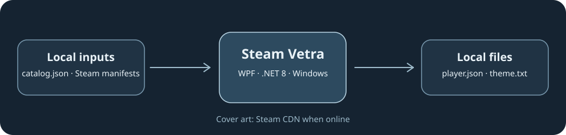

# Steam Vetra

**[Português](#português) · [English](#english)**


> Imagem capturada da edição deste repositório. As capas são carregadas da Steam e podem faltar sem internet.

## Português

Steam Vetra é um catálogo de jogos para Windows. **Esta edição compila e abre**, mas seus recursos são limitados aos listados abaixo. **Ela não ativa chaves, não concede licenças, não instala jogos e não aplica correções de DRM.**

### Recursos disponíveis

| Recurso | Funcionamento |
| --- | --- |
| Catálogo e busca | Lê `catalog.json` e filtra por título, gênero ou AppID. |
| Capas | Carrega imagens do CDN da Steam; requer internet. |
| Loja | `View on Steam` abre a página oficial do jogo. |
| Biblioteca local | Permite adicionar títulos, identifica instalações pelos arquivos locais da Steam e abre jogos instalados pelo cliente Steam. `Remove` tira o título da lista local sem desinstalá-lo. |
| Perfil | Nome e foto salvos somente neste computador. |
| Temas | Glass, GTA 6 e CodeNexus, com preferência local. |

**Retirado por medidas de segurança:** módulo anti-crack, vínculo por HWID, geração, validação e ativação de chaves, integrações privadas de provisionamento, ferramentas de modificação de DRM e configuração de produção. Os botões `Activate Key`, `Fixes` e `Install` e seus fluxos não estão nesta edição. Não há servidor de ativação incluso. Capturas da versão privada que mostrem esses botões não representam o código publicado.

### Requisitos

- Windows 10 ou 11, x64.
- [.NET 8 SDK](https://dotnet.microsoft.com/download/dotnet/8.0) para compilar. Um binário compilado exige o .NET 8 Desktop Runtime.
- Internet para restaurar o pacote NuGet e carregar capas. Após compilar, o programa abre offline, sem as capas não armazenadas em cache.
- Steam para identificar instalações e abrir jogos locais. Catálogo e perfil funcionam sem Steam.

### Compilar e executar

No PowerShell, na pasta do repositório:

```powershell
dotnet restore .\CatalogEntitlementManager.csproj
dotnet build .\CatalogEntitlementManager.csproj -c Release
dotnet run --project .\CatalogEntitlementManager.csproj -c Release
```

O executável fica em `bin\Release\net8.0-windows\CatalogEntitlementManager.exe`. O build copia `catalog.json` para a pasta de saída. Mantenha esse arquivo junto do executável se distribuir manualmente.

### Como usar

1. Busque pelo nome, gênero ou AppID.
2. Use `View on Steam` para abrir a loja oficial.
3. Abra `Library` para ver a coleção e as instalações detectadas. `Add game` adiciona um título do catálogo; `Remove` retira somente o registro local.
4. Em `Library > Profile`, defina nome e foto.
5. Escolha o tema na barra superior. A preferência fica salva neste computador.



O diretório `%LOCALAPPDATA%\CatalogEntitlementManager.Community` contém `player.json` (perfil, foto incorporada e coleção) e `theme.txt` (tema). O aplicativo também lê manifestos de instalação em `steamapps`. O projeto não hospeda perfis. As capas são requisitadas ao CDN da Steam.

### Estrutura do projeto

```text
catalog.json                  Lista de títulos
Storage/LocalGameLibrary.cs  Coleção, perfil e detecção local da Steam
UI/ViewModels/               Busca e estado da interface
UI/Views/                    Janelas WPF
docs/images/                 Imagens deste README
```

### Prompt para continuar com uma IA

Use este texto e preencha apenas as especificações do **seu próprio serviço de licenças**. O backend privado e as credenciais removidas não acompanham o repositório.

```text
Trabalhe no repositório Steam Vetra (WPF, .NET 8, Windows x64).
Leia README.md, CatalogEntitlementManager.csproj, Storage/LocalGameLibrary.cs,
UI/ViewModels e UI/Views. Preserve catálogo, biblioteca, perfil e temas.

Objetivo: implementar um fluxo de licença usando um serviço sob meu controle,
independente dos módulos privados removidos. Vou fornecer:
- contrato da API: [documentação ou OpenAPI]
- formato de chave e resposta de ativação: [especificação]
- regra de vínculo ao dispositivo, se existir: [especificação]
- origem das credenciais em runtime: [especificação]

Identifique dados técnicos indispensáveis ainda ausentes antes de codificar.
Implemente cliente HTTP com timeout, cancelamento e tratamento de falhas;
mostre estados claros na interface. Nunca exiba ou registre a chave completa.
Não grave tokens, chaves ou endpoints privados no repositório. Armazene
segredos locais de modo apropriado e separe desenvolvimento de produção.
Não simule ativação bem-sucedida.

Entregue código completo, configuração de exemplo sem segredos, testes do
contrato e instruções exatas. Execute dotnet build e os testes disponíveis.
Relate o que foi verificado e o que depende do meu serviço para validar
de ponta a ponta.
```

## English

Steam Vetra is a Windows game catalog. **This repository edition builds and launches**, with only the features listed below. **It does not activate keys, grant licenses, install games, or apply DRM fixes.**

### Available features

| Feature | Behavior |
| --- | --- |
| Catalog and search | Reads `catalog.json`; filters by title, genre, or AppID. |
| Cover art | Fetches images from Steam's CDN; internet required. |
| Store links | `View on Steam` opens the official store page. |
| Local library | Adds catalog titles, detects installations from local Steam files, and launches installed games through Steam. `Remove` only removes a local list entry. |
| Profile | Name and photo are saved on this computer only. |
| Themes | Glass, GTA 6, and CodeNexus, with a locally saved preference. |

**Removed for security reasons:** the anti-crack module, HWID binding, key generation/validation/activation, private provisioning integrations, DRM modification tools, and production configuration. `Activate Key`, `Fixes`, and `Install` and their workflows are absent. No activation server is included. Screenshots of the private version showing those buttons do not represent this repository edition.

### Requirements and setup

- Windows 10 or 11, x64.
- [.NET 8 SDK](https://dotnet.microsoft.com/download/dotnet/8.0) to build. A compiled binary needs the .NET 8 Desktop Runtime.
- Internet for NuGet restore and cover art. After building, the app can launch offline without uncached covers.
- Steam for installed-game detection and launching local games. Catalog and profile also work without Steam.

From PowerShell in the repository root:

```powershell
dotnet restore .\CatalogEntitlementManager.csproj
dotnet build .\CatalogEntitlementManager.csproj -c Release
dotnet run --project .\CatalogEntitlementManager.csproj -c Release
```

The executable is `bin\Release\net8.0-windows\CatalogEntitlementManager.exe`. The build copies `catalog.json` to the output folder; keep it beside the executable for manual distribution.

### Using the app

1. Search by title, genre, or AppID.
2. Choose `View on Steam` to open the official store page.
3. Open `Library` for added titles and detected installations. `Add game` adds a catalog title; `Remove` deletes only its local entry.
4. Open `Library > Profile` to set a local name and photo.
5. Select a theme in the top bar; the preference is saved on this device.

The screenshot and diagram above show this repository edition. `%LOCALAPPDATA%\CatalogEntitlementManager.Community` holds `player.json` (profile, embedded photo, collection) and `theme.txt` (theme). The app reads Steam installation manifests under `steamapps`; it does not host profiles. Cover art is requested from Steam's CDN.

### Continue development with an AI coding agent

Fill in the details of a license service **you control**. The private backend and removed credentials are not in the repository.

```text
Work in the Steam Vetra repository (WPF, .NET 8, Windows x64).
Read README.md, CatalogEntitlementManager.csproj, Storage/LocalGameLibrary.cs,
UI/ViewModels, and UI/Views. Preserve the catalog, library, profile, and themes.

Goal: implement a license flow for a service under my control, independent
of the removed private modules. I will provide:
- API contract: [documentation or OpenAPI]
- key format and activation response: [specification]
- device-binding rule, if any: [specification]
- runtime credential source: [specification]

Identify essential missing technical details before coding. Implement an HTTP
client with timeouts, cancellation, and error handling, and clear UI states.
Never display or log a complete key. Do not commit tokens, keys, or private
endpoints. Store local secrets appropriately and separate development from
production configuration. Do not simulate successful activation.

Deliver complete code, a secret-free example configuration, contract tests,
and exact build/run instructions. Run dotnet build and available tests.
State what was verified and what requires my service for end-to-end testing.
```